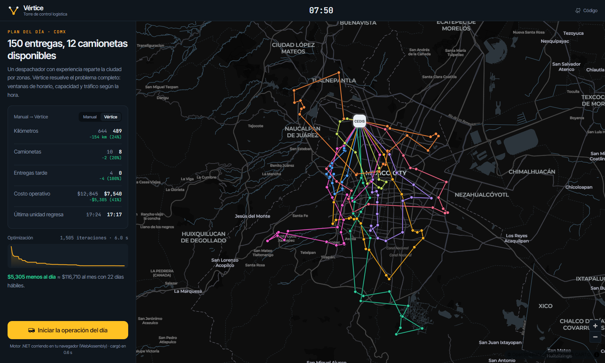
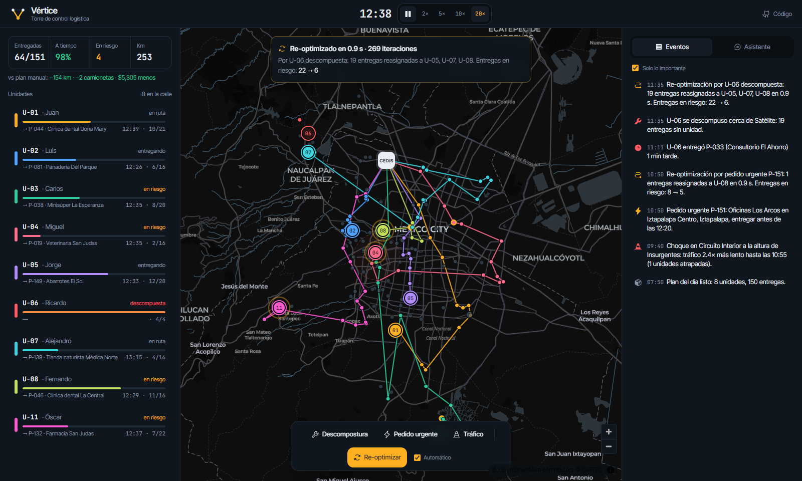
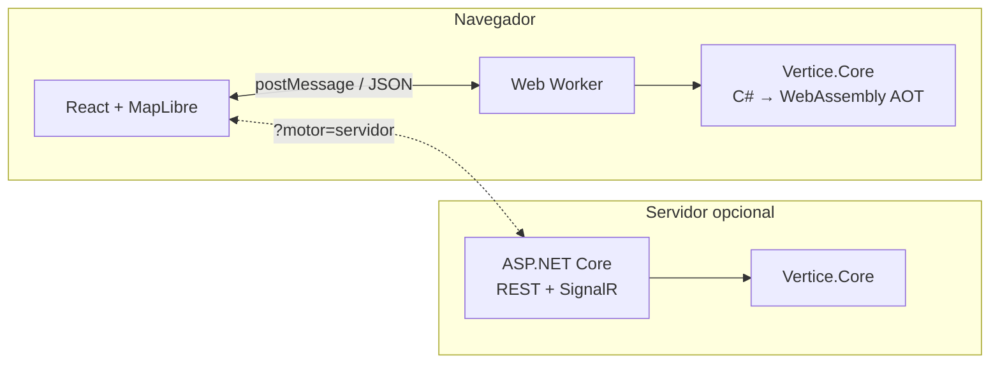

# Vértice · Torre de control logística

**Optimiza las rutas de reparto del día y re-planea en vivo cuando algo cambia**: una camioneta que se descompone, un pedido urgente o un choque en Circuito Interior.

**Demo en vivo:** [alexmar.mx/vertice](https://alexmar.mx/vertice/). Todo corre en tu navegador: el motor de optimización está escrito en C# y compilado a WebAssembly, sin servidor.



## Qué resuelve

Un CEDIS en Vallejo tiene 150 entregas para hoy en la CDMX y 12 camionetas. Cada cliente tiene su horario: unos reciben solo en la mañana y otros solo de 2 a 4. Las camionetas tienen capacidad limitada, y el mismo trayecto tarda el doble a las 18:30 que a las 11:00.

| Día de prueba (150 entregas) | Plan manual | Vértice | Diferencia |
|---|---|---|---|
| Kilómetros | 644 | ~490 | **−24 %** |
| Camionetas usadas | 10 | 8 | **−2** |
| Entregas tarde | 4 | 0 | **−4** |
| Costo operativo del día | $12,845 | ~$7,500 | **−41 %** (≈ $117 mil al mes) |

El "plan manual" no es un rival de paja: es como lo arma un despachador con experiencia. Reparte la ciudad por zonas (unas 15 paradas por chofer) y, dentro de cada zona, atiende primero a quien cierra temprano yendo siempre al cliente más cercano.

## La operación en vivo



- **El reloj corre** y las unidades se mueven. El tiempo real de cada tramo varía contra lo planeado (semáforos, clima, suerte).
- **Predicción de retrasos:** con el tráfico de ese momento, cada entrega pendiente tiene su hora estimada y se marca *en riesgo* o *llegará tarde* antes de que pase.
- **Re-optimización en vivo, en menos de 1 segundo:**
  - Si una camioneta se descompone, sus entregas se reparten entre las demás.
  - Si entra un pedido urgente, se mete donde menos afecta.
  - Las unidades en camino conservan la parada a la que van, y mover una entrega ya avisada al cliente tiene un costo, así que el plan no se revuelve sin necesidad.
- **Asistente de operación:** responde con los datos en vivo preguntas como "¿por qué va tarde la U-07?", "¿qué está en riesgo?", "¿dónde va el P-045?" o "¿cuánto llevamos ahorrado?". Es determinista: cada cifra es auditable y no hay respuestas inventadas.
- **Día guiado:** durante el día ocurren 2 choques, 3 pedidos urgentes y 1 descompostura, que es lo que pasa en una operación real.

## Cómo funciona por dentro



- **`Vertice.Core`**: el motor, en C# puro y sin dependencias. El mismo código corre en el navegador y en el servidor.
  - **Modelo:** VRPTW (ruteo con ventanas de horario y capacidad) con **tiempos dependientes de la hora**. La velocidad en la CDMX va de 17 km/h (18:00) a 34 km/h (madrugada). La distancia vial es la línea recta × 1.35, el factor de rodeo de las calles. Los incidentes alentan los tramos que tocan su zona.
  - **Optimizador ALNS** (*Adaptive Large Neighborhood Search*, Ropke & Pisinger 2006):
    - Destruye parte del plan con 4 operadores: al azar, lo más caro, entregas parecidas (Shaw) o una ruta completa.
    - Lo reconstruye con inserción barata o con *regret-2*.
    - Acepta con recocido simulado, y los operadores que más mejoran se eligen más.
    - Al final pule cada ruta con 2-opt.
  - **Costo en pesos:** km × $4.6, $650 por sacar una unidad, retraso $14/min, horas extra $6/min, chofer esperando $1.5/min y $140 por reasignar una entrega ya avisada.
  - **Rendimiento:** unas 1,500 iteraciones en 6 s en el navegador (AOT) y unas 1,800 en 4 s en nativo. Al evaluar inserciones se poda en cuanto el costo parcial rebasa al mejor encontrado.
  - **Simulación:** minuto a minuto, con la parada en curso comprometida al re-planear.
- **`Vertice.Wasm`**: expone el motor con `[JSExport]` y lo compila **AOT** (unas 6 veces más rápido que interpretado). Pesa 1.8 MB comprimido.
- **`Vertice.Api`**: ASP.NET Core con un hub de **SignalR** (una operación por conexión; el avance del optimizador llega en vivo por un `Channel`) y REST (`POST /api/plan`, `GET /api/health`).
- **`web`**: React 19 + TypeScript + Tailwind 4 + MapLibre GL, con el mapa base de CARTO/OpenStreetMap.

## Correrlo

Requisitos: .NET 10 SDK y Node 24.

```bash
# pruebas (16): motor + API con servidor en memoria y cliente SignalR
dotnet test

# demo con el motor en el navegador
dotnet workload install wasm-tools   # una vez, para AOT
cd web && npm ci && npm run wasm && npm run dev
# → http://localhost:5180

# modo servidor (el motor corre en la API)
dotnet run --project src/Vertice.Api       # :5090
# → http://localhost:5180/?motor=servidor

# o todo en Docker
docker build -t vertice . && docker run -p 8080:8080 vertice
```

## Decisiones y límites (honestos)

- **Las rutas se dibujan en línea recta entre paradas.** Las distancias y los tiempos sí consideran el rodeo de las calles. Para geometría vial real se conectaría un motor de ruteo como OSRM o Valhalla sin tocar el optimizador.
- **El tráfico es un perfil por hora más variación aleatoria e incidentes simulados**, no datos en vivo. El modelo está aislado en `TravelModel`, así que conectar una API de tráfico es reemplazar una clase.
- **Al re-planear en ruta se asume transbordo:** si una entrega pasa de una camioneta descompuesta a otra, la mercancía se cambia de unidad. Una unidad que regresa al CEDIS sí recarga.
- **Clientes y pedidos son ficticios.** Las colonias son reales con coordenadas aproximadas, y el escenario es reproducible con su semilla.

---

Hecho por **Omar Alejandro Maravillo** · [alexmar.mx](https://alexmar.mx)
